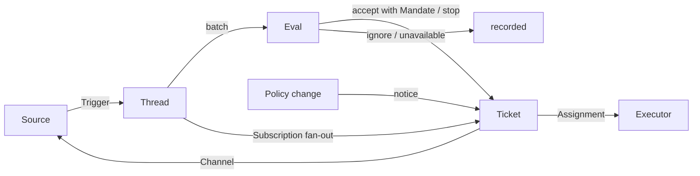

# 001 领域模型（Domain model）

> 中文译本，仅助读；英文原文为权威版本：见原型仓库 `dsh-superagent-prototype/docs/001-domain.md`（翻译于 2026-11-17）。

本文档为 dsh-superagent 命名各概念及每个概念守住的规则。代码、agent 调用的工具、面板和其他文档只使用这些术语，不用别的。遵循 [000 哲学](000-philosophy.zh.md)，模型只保留工作需要的概念；一个业务需要会变成某个概念的属性。

## 流程

工作从 Trigger（触发）流向 Eval（评估）再到执行。Source（来源）产出 Trigger。一个 Trigger 扇出为上下文，送达订阅了其 Thread（线程）的各张 Ticket（工单）。以这种方式到达某张 Ticket 的人的消息留在该 Ticket；其他每个 Trigger 进入 Eval，由 Eval 决定是否发起的新工作。Eval 接受时，创建一张携带 Mandate（授权）的 Ticket。Assignment（派工）把 Ticket 交给 Executor（执行器），结果经 Channel（渠道）写回 Source。

## 概念

Source、Thread、Eval、Mandate 和 Subscription 构成核心领域；其余概念起支撑作用。

| 概念 | 定义 | 它守住的规则 | 它为何存在 |
| --- | --- | --- | --- |
| Source（来源） | 一条事件流。Source 种类（kind）是可复用的实现；Source 实例（instance）是某个种类的一份配置：是否运行、监听什么 | 持有自己的读取位置和自己的 bot 身份。定义什么算一个事件，包括只在时间上成立的条件。在进入领域之前，丢掉 bot 自己的消息和它不监听的范围之外的 Trigger。把每个 Trigger 翻译成它所属的 Thread 及可回复的 Channel 地址 | 重启不得重放事件 |
| Trigger（触发） | 一个不可变事件，携带 Source 自己的元数据，如行为者（actor） | 属于一个或多个 Thread。同一 Trigger 被接受两次只创建一张 Ticket | 审计与幂等的基本单位 |
| Thread（线程） | 按时间排列的多个 Trigger；由 Source 定义哪些 Trigger 构成一个 Thread | 同一时刻至多一个 Eval 在它上面运行。它可以关联多张 Ticket。它持有自己的 Subscription、正在运行的 Eval 和决策历史 | 给 Eval 一致的视图和上下文 |
| Correlation（关联） | 一个 Trigger 同时所属的多个 Thread 之间的关系 | 只补充上下文；从不路由 | 让 Eval 能追随相关的证据 |
| Channel（渠道） | 一个 Thread 的写侧；其地址由 Source 定义 | 一个 Thread 可以有多个 Channel；一张 Ticket 持有一组 Channel | 确认、回复、pull request、被 resolve 的评审，都是写 |
| Policy（策略） | 版本化的研判规则，加上每个 Source 的部分：在该 Source 自己的身份体系里，谁可以通过它发起工作、名单如何同步、哪些 bot 可以产生候选 | Policy 版本覆盖规则、接受模式（accept mode）和各 Source 的部分。一项影响在途 Ticket 的变更（例如它据以被接受的规则变了）会送达该 Ticket 的 Assignment；变更不撤销 Mandate。不同 Source 上的身份之间绝不做相互映射 | 规则变化时，正在运行的 Eval 必须作废 |
| Eval（评估） | 对一批 Trigger 的研判，分两层：准入（Gate）与研判（Assessment） | 输入：Trigger 批次、Thread 快照、该 Thread 上的每张 Ticket（含已结束的）、当前 Policy。输出：一个 Decision（决定）。自身不持有状态 | 决定新工作是开始、继续还是停止 |
| Mandate（授权） | 一次接受所授予的东西：Policy 版本、范围（scope）、强度（strength）、命中的规则、发送者在该 Source 上的身份、Source 收到该 Trigger 的方式 | 不可变；更宽的范围意味着一张新 Ticket。Ticket 结束不结束它：只有人的停止（stop）能撤回它，不再容纳它的 Policy 能撤销（revoke）它。已结束的 Ticket 恢复前要对照当前 Policy 重新校验 | 说明这项工作为什么可以做、可以做到哪 |
| Ticket（工单） | 一项被授权的工作单元 | 只有 Eval 能创建。指向它的 Mandate；持有它的 Channel 和 Input。open（打开）→ ended（结束），当人的消息落在它的某个 Thread 上时回到 open——除非是被人工停掉的。它定义自己的状态，不跟随 Executor 的状态 | 拥有这次执行及其报告 |
| Assignment（派工） | Ticket 与一个 Executor 实例的绑定 | 一张 Ticket 历史上可以有多任。pending（待启动）→ running（执行中）→ ended（已结束），独立于 Ticket 演进。只有它的最终报告能在 Executor 一侧结束这张 Ticket | Executor 在领域之外，但"谁在执行"必须在领域之内 |
| Subscription（订阅） | Ticket 与 Thread 之间的多对多关系，由 Thread 持有 | 一个匹配的 Trigger 扇出到每张活着的订阅 Ticket，不检查发送者是谁；以这种方式到达 Ticket 的一个人的消息不走 Eval。Executor 仅作上下文追随的 Thread，以同样方式到达它的 Ticket，但不授予任何权力、也不能恢复已结束的 Ticket。已结束的 Ticket 保留它的 Subscription——包括一个已关闭或已合并的 pull request 的订阅：人的消息能以同一 Mandate 恢复它，无需 Eval、无需 Decision；bot 和 CI 的消息不能到达它，因为它的 Executor 恢复时会重读它的 Thread。被人工停止的 Ticket 收不到任何东西。主 Session 只有在消息明确指向某张 Ticket 时，才把一个 Thread 附到那张已存在的 Ticket 上。人可以撤掉一个 Thread 上的全部 Subscription；Executor 只能撤掉自己 Ticket 对某个它认定无关的 Thread 的订阅——它自己的 Ticket 起源于的那个 Thread、以及 Source 让它追随的 Thread（比如它的 pull request）除外 | 后续的讨论不需要有人再次 @ 这个 agent，就能到达 Executor |

人不是领域概念。一个 Trigger 携带其行为者在 Source 上的标识。允许名单是 Policy 中属于某个 Source 的部分，用该 Source 自己的身份。同一个人在多个 Source 上有账号这件事，是 agent 需要时读到的 prompt 文本。

Executor 及其 Session 与目录在领域之外，通过 Assignment 接入。

聚合：Source 持有读取位置。Thread 持有它的 Subscription、正在运行的 Eval（串行执行，期间到达的 Trigger 合并进下一批）和决策历史。Ticket 持有它的 Assignment、Channel 和 Input，并按 id 引用 Decision。

## 被拒绝的概念

| 被拒绝 | 原因 |
| --- | --- |
| Principal（主体）或 Membership（成员资格）作为实体，或跨 Source 映射身份 | 人是 Trigger 的元数据；允许名单是 Policy 中 Source 的部分；跨 Source 的映射是 prompt 文本 |
| Eval 自己调度延时的 Trigger | 需要等待的条件就是一个普通的 Source，因此 Eval 永远不反向依赖 Source |
| Waiting（等待）或 revoked（已撤销）的 Eval 状态 | 等待属于 Source；超时的 Eval 把它的 Trigger 重新排队，或以 `unavailable`（未完成）结束 |
| 每个 Thread 至多一张活着的 Ticket | 一个 Thread 可以承载多件独立的工作；研判用 Ticket 列表避免重复 |
| "追加到 Ticket"的 Decision | 追加就是 Subscription 扇出，不需要 Eval |
| 对 Subscription 做准入检查 | Subscription 覆盖整个 Thread；Mandate 把授权与上下文分开 |
| 会路由的 Correlation | 路由由 Subscription 完成；Correlation 只补充上下文 |
| Ticket 状态跟随 DSH Session | Ticket 可能被交接、恢复、或由多个 Executor 执行，所以它定义自己的状态 |
| Executor 宣称"有人让我停" | 停止的强度只有 Eval 能判定 |
| Policy 变更时取消在途 Ticket | 取消会留下做了一半的工作；变更被记录并送达，而不是取消 |
| Executor 失败或卡住时锁定其 Session 的全部工具 | 那会拒绝直接在 Session 里工作的人，以及恢复后的报告；暂停自动输入就够了 |
| 从报告的自由文本推断"正在等人" | 分类需要结构化事实；Executor 通过结构化字段来问 |

## 什么是可复用的

上述概念及其规则是可复用的。Source 的实现、Policy 的内容、Executor 和 Channel 的实现属于具体部署。每个 Source 内部保留自己的用语——消息、聊天、通知——并翻译成 Trigger。

| 部分 | 在本仓库中 |
| --- | --- |
| Source | Feishu：实时事件、历史恢复、订阅话题的轮询。GitHub：通知、订阅的 Issue 与 pull request、CI 变化、PR 的合并与关闭，以及（在开关打开时）仓库内每个新 Issue、新 pull request、新评论和默认分支的 CI |
| Policy | 研判规则，加上每个 Source 的允许名单及其同步、bot 名单和准入表 |
| Executor | 一个 DSH Executor Session 和每张 Ticket 一个目录，运行在由 Executor 和各 Source 注册变量的执行环境中 |
| Channel | Feishu 话题回复；GitHub 评论与评审线程（review thread）回复 |

## 术语表

供本篇及后续文档参考的名词清单，附中文名；后文解释此处未展开的术语。面板一次只显示一种语言；(?) 按钮打开这份带双语的术语表。agent 在 GitHub 和 Feishu 上对人说的话用平实语言，不用这些术语。

| 术语 | 中文 | 含义 |
| --- | --- | --- |
| Agent | 智能体 | dsh-superagent 运行的自动化团队成员，通过 GitHub 账号、Feishu bot 等身份在 Source 上行动 |
| Main Session | 主 Session | 对 Trigger 做评估、接受并派发 Ticket、负责回复的那个 DSH Session；代码与 prompt 中叫 `orchestrator` |
| Executor Session | 执行器 Session | 一个 Executor 为一张 Ticket 运行的 DSH Session；代码中叫 `worker` |
| Source | 来源 | 一条事件流：一个插件提供的种类，加一份实例配置 |
| Trigger | 触发 | 来自 Source 的一个不可变事件 |
| Thread | 线程 | 按时间排列的 Trigger；Eval 在其内一次一串地运行 |
| Correlation | 关联 | 共享同一个 Trigger 的多个 Thread 之间的关系；只补充上下文 |
| Channel | 渠道 | 一个 Thread 的写侧 |
| Policy | 策略 | 版本化的接受工作规则，及每个 Source 的部分，如谁可以在那里请求工作 |
| Policy version | 策略版本 | 规则、Source 部分、接受模式的一组组合的标识；每个 Mandate 都记录它 |
| Eval | 评估 | 把一批 Trigger 变成一个 Decision 的过程 |
| Gate | 准入 | Eval 的确定性第一层：谁可以发起工作、以什么强度 |
| Assessment | 研判 | Eval 中模型的判断 |
| Decision | 决定 | Eval 的结果 |
| Mandate | 授权 | 一次接受所授予的：强度、范围、依据的 Policy 版本 |
| Ticket | 工单 | 一项被授权的工作单元 |
| Assignment | 派工 | Ticket 与一个 Executor 实例的绑定 |
| Subscription | 订阅 | Ticket 与 Thread 之间的关系 |
| Fan-out | 扇出 | 把被订阅 Thread 的 Trigger 作为上下文送达一张 Ticket |
| Executor | 执行器 | 运行 Assignment 的端口：一张 Ticket 一个 Executor Session、一个目录 |
| Execution environment | 执行环境 | Executor Session 和 prepare 命令运行之处：由 Executor 和各 Source 注册的变量，每个有键、值和说明 |
| Report | 报告 | 一个 Assignment 向它的 Ticket 报告的状态 |
| Attention | 待人工决定 | 一张 Ticket 上等待人回答的问题 |
| Disposition | 去向 | 一个 Trigger 被过滤、被评估或被扇出的记录 |
| Input | 输入 | 送达一张 Ticket 的上下文：扇出的 Trigger、Policy 变更、恢复（resume）与文本 |
| Scope | 范围 | 一个 Mandate 允许的工作 |
| Strength | 强度 | 一个 Mandate 或 Eval 的依据有多强 |

| 组 | 取值 |
| --- | --- |
| Decision | accept 接单 · stop 停止 · ignore 忽略 · unavailable 未完成 |
| Strength | explicit 明确 · inferred 推断 |
| Assignment | pending 待启动 · running 执行中 · ended 已结束 |
| Report | progress 进展 · waiting 等待 · ready 就绪 · blocked 受阻 · failed 失败 · dropped 无需处理 |
