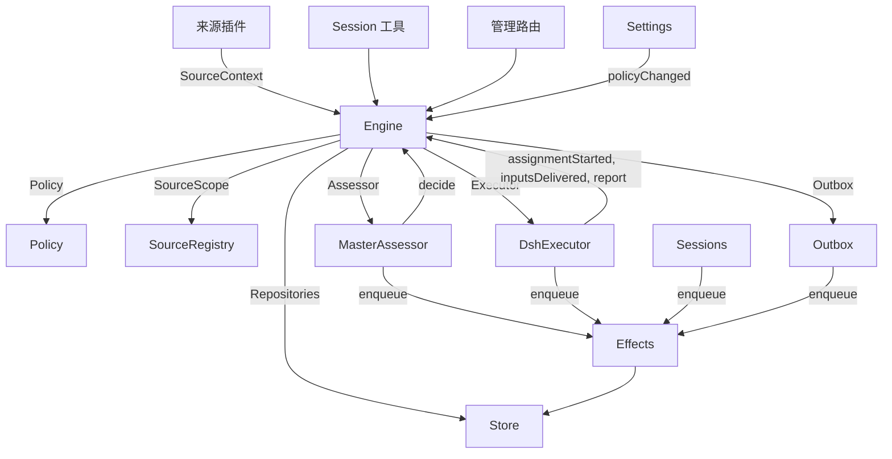

> 中文译本，仅助读；英文原文为权威版本：见原型仓库 `dsh-superagent-prototype/docs/007-architecture.md`（翻译于 2026-11-17）。

# 007 架构

本文是实现层面的开发者指南。它把 [001 领域模型](001-domain.zh.md) 到 [006 部署](006-deployment.zh.md) 中的概念映射到类、接口与文件。请先看运行时与 Engine（引擎），再把模块表和测试表当作代码索引。

## 核心类与粘合层

核心类在小接口背后拥有领域概念与外部边界。粘合层把工具参数、HTTP 请求、来源（Source）载荷和 DeepSeek Harness 事件转换成对这些类的调用，再把结果变成卡片、视图和消息。

`Runtime`（`src/app/runtime.ts`）构造整个应用、提供依赖，并负责启动与关闭。`Engine` 自行构造其内部部件。因为执行器（Executor）与研判器（Assessor）会回调 Engine，Runtime 交给它们的是 getter，而不是要求按某个循环顺序构造。

### Runtime

`Runtime` 是组合根（composition root），其中不含任何领域规则。它的构造函数锁定状态目录、打开 Store 并逐个构建组件。若构建失败，它关闭 Store 并释放锁。

启动阶段注册管理路由并运行 Setup。Setup 完成后，它安装 Session 与执行器钩子、确保主 Session（Main Session）存在、启动策略同步、恢复被中断的派工（Assignment），并启动巡检（pass）与副作用（effects）。`ready` 标记启动完成。

关闭时它取消回合，等待巡检、副作用与 agent 结束，恢复进程环境，关闭 Store 并释放锁。来源插件通过窄接口 `SourceHost` 把 Runtime 作为 `orchestrator` 服务注入。

| 部件 | 模块 | 作用 |
| --- | --- | --- |
| Setup | `src/app/setup.ts` | 解析仓库与账号：按 worker shell 的运行方式探测它们的 CLI，写入并应用 worker 的环境与命令 shim，并保留 setup 问题；Settings 通过它检查变更过的账号，也通过它重启，而重启会再次运行 setup |
| 巡检 | `src/app/passes.ts` | 一次只跑一个巡检，每两秒一次，并在任何命令要求时立即跑一次：先处理到期的副作用，再调用 `Engine.evaluateDue`；来源的触发（Trigger）经由它到达 Engine |
| 发件箱（Outbox） | `src/app/outbox.ts` | Engine 的 `Outbox` 端口，也是回执的唯一写入者：`send` 在一个事务里保存消息回执并把它对应的 `reply` 副作用入队，该副作用的处理器通过 `SourceRegistry.send` 发送消息；来源关闭期间消息等待，会话已不存在或未被监听时消息被丢弃 |
| 通知 | `src/app/notices.ts` | 把领域事件与 worker 活动转换成主 Session 的消息。`eventNotice` 处理领域通知；`reportRelay` 立即转发问题、把普通进展留驻在其工单上，并转发其他报告；`followupRelay` 指明拥有人工跟进（follow-up）的工单。回合进行中到达的转发会在下一步一并投递，经由 DeepSeek Harness 的 inbox |

### Engine

`Engine`（`src/core/engine.ts`）是触发、线程（Thread）、决定（Decision）、工单（Ticket）与派工的唯一写入者。它从 `src/core/ports.ts` 接收这些端口：`Repositories`、当前策略的 getter、`SourceScope`、`Assessor`、`Executor` 与 `Outbox`。可选依赖是 `prepareTicket`、`now` 与 `emit`。

Engine 的所有方法都是同步的。每条命令在一个事务内修改其聚合。`evaluateDue` 为它改动的每个评估（Eval）或工单各用一个独立事务。端口在事务内把外部工作入队；适配器在提交后执行它。非法请求抛出 `UserError`。

Engine 只暴露一个入口，并委派给五个内部部件。每条命令的事务由它自己拥有。跨部件的命令，例如 `attach`、`evaluateDue` 与 `policyChanged`，按顺序调用各部件。

每个部件都继承 `EnginePart`（`src/core/part.ts`），后者提供选项与共享读取。部件之间的依赖是单向的：

| 部件 | 职责 | 依赖 |
| --- | --- | --- |
| `Intake` | 来源的触发：连同其去向（Disposition）只存储一次，记录到它所在的线程及其关联（Correlation）上，扇出（Fan-out）给已订阅的工单，并且——除非它是已经到达某个工单的人的消息——在其主线程上排队等待评估 | 工单 |
| `Evals` | 线程的评估：批量、准入（Gate）的强度（Strength）、actor 与依据以及给出它们的触发（`primary`）、由候选投递时间得出并经暂停位移的截止时间、过期评估的重新入队、候选、重放与交回、策略（Policy）变更时的重新入队，以及每个评估最终得到的决定：接受、停止、忽略或不可用 | 工单 |
| `Tickets` | 工单生命周期：接受时一并创建工单及其授权（Mandate）、订阅（Subscription）与首次派工；它跟随的线程及其关闭（`followsDone`）；附加的线程与为获取上下文而跟随的线程；输入（Input）与备注；恢复以及恢复会拒绝的消息；重试、重启、停止与结束；它丢弃的订阅；以及把策略变更通知到受影响的工单 | 回复 |
| `Assignments` | 执行器及其 worker 上报的内容：派工已开始、输入已到达或未能到达、重启中断了派工，以及 worker 的报告（Report）和其中向人提出的问题 | 工单、回复 |
| `Replies` | 通过 `Outbox` 的渠道（Channel）写入：确认、回答、结果与待人工决定（Attention）消息，各自按允许它的规则发送 | 无 |

命令用祈使式命名，例如 `stopTicket`；适配器上报的事实用以过去式命名，例如 `assignmentStarted`。查询 `candidate` 用名词。

调用方只会拿到其角色对应的 Engine `Pick`：`EngineForSources`、`EngineForMainSession`、`EngineForPeople`、`EngineForSettings` 或 `EngineForExecutor`。

| 角色 | 方法 | 效果 |
| --- | --- | --- |
| 来源 | `receive(trigger)` | 只存储一次触发并回答 `stored`、`duplicate`，或当没有来源接收它时回答 `filtered`；把它扇出给订阅其线程的工单——其中，如果它是人的消息，则立即恢复已结束的工单（除非处理已暂停）——并在其主线程上排队等待评估，除非它是已经到达某个工单的人的消息，那种情况归该工单处理 |
| 来源 | `bindThread(ticketId, thread, own)` | 让未结束的工单跟随来源的某个线程，例如某个 pull request 的线程，`own` 表示该工单创建了它；已关闭的线程被再次绑定时重新打开。结束工单的是线程的关闭，而不是一份 `ready` 报告 |
| 来源 | `threadClosed(thread, outcome, at)` | 某个线程关闭：所有跟随它的未结束工单都记录这次关闭，并在它跟随的线程都处理完之后结束（`followsDone`）：它打开的线程都不再打开，或者它没有打开任何线程时，它跟随的每个线程都已关闭。它以这些关闭中最新一次的方式结束为 `merged` 或 `closed`；除非关闭之后恢复的工作尚未上报 `ready`，或它的执行器已在最近一次非 `progress` 的报告之后（或在其上一回合结束之后）做出决定，通过确认或回答接手了某个人的跟进；此时一份 `dropped` 报告会按那次关闭的结果结束它 |
| 主 Session | `candidate(triggerId)` | 持有某触发的评估，按其研判器的视角呈现 |
| 主 Session | `candidateDelivered(evalId)` | 该评估的候选已到达主 Session：截止时间从此刻起算 |
| 主 Session | `decide(triggerId, outcome)` | 记录评估决定，或为显式请求记录直接决定。接受会原子地创建工单、授权、派工、订阅与确认。从卡片上忽略的推断候选会先记录 `ignoredFromCard`，再记录给出的理由。当 `followupOwners` 仍拥有人工跟进时，只允许停止 |
| 主 Session | `attach(ticketId, triggerId, note?)` | 把触发路由到它指向的工单，该工单的执行器随后将其作为跟进处理，并结束持有它的评估（该评估的其他触发等待新一轮评估）；已结束的工单在授权下立即恢复，除非处理已暂停。执行器仍在决定的跟进会被拒绝；被路由回交出它的那个工单也会被拒绝 |
| 主 Session | `requestStatus(ticketId)` | 向等待中的执行器 Session 询问状态，并回答是否已询问 |
| 主 Session | `note(ticketId, text)` | 把来自其他工作的事实作为文本输入交给工单的执行器，这不授予任何权限 |
| 主 Session、执行器 | `reply(request)` | 为消息目的所指的渠道排队一条消息：`acknowledgement`、`answer`、`result` 或 `attention` |
| 人 | `stopTicket(ticketId, reason?)` | 人的停止操作，会撤回授权 |
| 人 | `retryTicket(ticketId)` | 结束在 `failed` 或 `blocked` 报告之后等待人的工单的停滞派工，或结束输入投递失败（`canRetry`）的工单的停滞派工，并启动一个新的派工 |
| 人 | `reevaluate(triggerId)` | 把已存储的触发排队进行新一轮评估 |
| 人 | `unsubscribe(thread)` | 丢弃某线程上的所有订阅，曾跟随它的工单不再跟随；每个工单继续决定它在那个线程收到的跟进 |
| 人 | `dismiss(decisionId)` | 关掉 `unavailable` 决定所显示的问题，该决定会记录这次处置 |
| 执行器 | `assignmentStarted(ticketId, assignmentId)` | 派工开始运行；等待中的输入随之发出 |
| 执行器 | `inputsDelivered(ticketId, assignmentId, inputIds)` | 输入已到达派工的执行器 Session（Executor Session），在那里每个输入等待某个步骤取用 |
| 执行器 | `inputsRead(ticketId, inputIds)` | 执行器 Session 把携带这些输入的消息取入其历史（一个 `user/message` Session 事件），模型由此获得它们；此前认领过它们、但在取消或失败之前未完成的步骤不计入。每个输入在随后出现一份报告或回合结束时算作已读，重启之后亦然，其工单结束也不会释放它；在读取记录出现之前投递的输入，在投递后出现报告或回合结束时算作已读 |
| 执行器 | `turnEnded(ticketId, assignmentId)` | 执行器 Session 的某个回合结束，报告之后亦然，只要没有后台工作为其运行、也没有交接给人的工作。一个步骤此前取用的内容即已读（`inputsRead`） |
| 执行器 | `deliveryFailed(ticketId, assignmentId, error)` | 投递输入失败；工单会一直显示该失败，直到一次投递成功、新派工开始或工单结束 |
| 执行器 | `report(ticketId, report)` | 记录报告及其向人提出的问题；`dropped` 结束工单，`ready` 完成不跟随任何线程的工单，并按跟随线程各自结束的方式结束该工单 |
| 执行器 | `markUnrelated(ticketId, thread, reason)` | 只丢弃该工单对某个它认为无关的附加线程的订阅，并连同理由交回该工单正在决定的此线程上的跟进 |
| 执行器 | `followForContext(ticketId, thread)` | 让未结束的工单为获取上下文而订阅相关线程：其消息会到达工单，但不为工单提供跟进强度，也不会恢复它 |
| 执行器 | `handback(ticketId, triggerId, reason)` | 记录工单交回某个到达它的触发，理由由该触发的候选携带，并在没有其他工单决定它时（如果此前是此工单决定的话）把它排队进行新一轮评估；返回是否已入队。一个工单对每个触发只交回一次，并保留其订阅 |
| 执行器 | `assignmentInterrupted(ticketId, assignmentId)` | 宿主停止时某个派工正在运行：工作中途被中断的派工，或在最近一次报告之后收到输入的派工，会带着恢复说明和已投递给它但执行器 Session 未取用的输入重新开始，如同一次重试；自那以后已报告过的派工则保留其 Session。DshExecutor 在启动时（`resume`）按最老工单优先逐个上报，并重新排队仍在等待的启动 |
| 巡检 | `evaluateDue()` | 除非处理已暂停：对排队触发仍等待的线程启动评估，每个线程一个，期间排队的触发合为一批；把已过截止时间的评估的触发再次排队，连续两次，第三次则把它记录为 `unavailable`；并在授权仍然有效时，恢复暂停期间被人消息到达的已结束工单。候选尚未到达主 Session 的评估不会过期。处理暂停期间没有评估过期，恢复之后每个截止时间按暂停时长后移 |
| 设置 | `policyChanged(from, to, effects)` | 告诉每个在线工单该变更以何种方式影响它（`src/policy.ts` 中的 `policyEffects`：它被接受时所依据的规则发生变更或不再适用、其请求者可能不再能发起工作，或主动工作不再被接受），并在新版本下重启进行中的评估 |

Engine 把批量、鉴权、扇出、恢复与待人工决定的生命周期规则保持为私有。几个共享谓词让这些规则保持一致：

- `waitsForPerson`（`src/core/model.ts`）：最近一次派工报告为 `blocked` 或 `failed`，且此后没有人的消息到达。此条件为真期间，自动输入与失败的启动都会被扣住。
- `followupOwners`：仍然负责在其自己的线程上收到的人工跟进的工单。工单可以是活跃的，也可以是未经人工停止就已结束、正等待恢复的。交回消息即结束该归属。
- `settled`：某个决定已经解决了该请求；停止、不可用、已路由与拒绝停止的决定不计入。
- `ticketStage`（`src/core/stage.ts`）：实现 [003 执行](003-execution.zh.md) 中的阶段表。

工单结束时，未读的跟进会回到评估，除非另一个工单仍拥有它们，或另一个去向已将它们了结。已确认、已回答与已交回的消息被排除在外。对于没有确认去向的旧记录，由发件箱回执提供该事实。最终报告也会涵盖派工开始时正在等待的消息，包括恢复它的那条消息。停止工单的那条消息不会被自动重新评估。

变更之后，Engine 从 `src/core/ports.ts` 的 `DomainEvents` 发出事件：

`trigger.received`、`eval.started`、`decision.recorded`、`ticket.created`、`ticket.resumed`、`ticket.ended`、`assignment.started`、`assignment.ended`、`thread.subscribed`、`thread.unsubscribed`、`trigger.requeued` 或 `policy.changed`。

Runtime 把 `ticket.ended`、`trigger.requeued` 与 `thread.unsubscribed` 变成通知。投递给工单的人的 `trigger.received` 会变成跟进转发。`pullEndNotices` 在工单以 merged 或 closed 结束时会用稳定的 id 发送一条聊天通知。其他事件目前没有消费者。

### 模型

`src/core/model.ts` 存放领域类型，`src/core/stage.ts` 存放工单阶段。决定用 `reason` 记录原因，它是 `Reason` 的列表（`src/core/reasons.ts`）：每个 `Reason` 是一个 `code`，带有其 `values`，对于一批中的一个触发还带有其 `triggerId`。

核心的代码，例如 `timeout`、`policyChanged`、`routed` 与 `startedTicket`，来自 `REASONS`，并带有 agent 通过 `reasonText` 读取的英文；准入或来源范围（Scope）会给出自己的代码，例如 `not_a_member`；而 `said` 携带研判器或人写下的原话。面板用 `reason.<code>` 表述每个代码，来源过滤掉的触发也以同样方式记录来源的代码。

工单对每个事实只保存一次。只要没有 `ended`，它就是未结束的；`ended` 记录何时、由谁、为何以及以什么结果结束；它最后说的内容是其最新的派工报告（`latestReport`）；它的执行器 Session 以它命名（`src/executor/dsh.ts` 中的 `workerSessionId`）。

其字段都带类型：`origin` 是赋予其评估批次强度的那个被准入的触发以及该批次本身（`triggerId`、`triggerIds`）；`execution` 是执行器所选的内容（`name`、`directory` 与 `assignment`）；`delivery` 是最后一次失败的输入投递（`error`、`at`），直到一次投递成功、新派工开始或工单结束；`follows` 是来源让它跟随的线程，每个为 `{thread, own, closed?}`：工单创建它时 `own` 为真，关闭后 `closed` 带有 `at` 与 `outcome`。只有 Tickets 部件写入 `follows`；GitHub 来源用 `pullsOf` 与 `pullOf` 读取其 pull request（`src/sources/github-pull.ts`）。

携带触发的输入会记录它是否由人书写，`waitsForPerson` 读取该标记。线程还会在 `context` 中列出仅为上下文而跟随它的已订阅工单，并在 `expired` 中统计其排队触发连续过期的评估数；评估则记录其 `primary` 触发以及候选的 `delivered` 时间。

触发的去向记录它到达的工单（经扇出或附加）、人的重新排队、每个交回它的工单及其理由，以及其执行器确认或回答过它的工单。

授权的 `basis`（`MandateBasis`）记录准入如何接纳其触发。重新校验会读取接收方的 `source`、`scope` 与 `row`，列出的 `sender`、匹配的 `rules`，以及 `via`：

| `via` | 准入依据 |
| --- | --- |
| `addressed` | 被允许的发送者直接向 agent 发起 |
| `followup` | 消息到达一个已有工单的线程 |
| `admission` | 准入表的一个单元格；`observation` 标记推断出的候选 |
| `bot` | 列表中的 bot 产生了推断出的候选 |

触发与线程的 `meta` 属于来源。核心不解释它们。

### 策略

`src/policy.ts` 定义设置 schema、鉴权与研判规则。`settingsPolicy(settings, scope)` 每次使用时返回一个全新的无状态 `Policy`：

- `version`、`paused` 与 `evalTimeoutMs` 描述其当前状态。
- `gate(trigger, thread, tickets)` 返回准入强度与依据。
- `revalidate(mandate)` 检查现有授权是否仍然有效。
- `admitsInferred(rules)` 仅在 auto 模式且存在已启用的匹配规则时允许主动接受。

`assessmentOutcome(assessment, settings, strength)` 把模型的研判（Assessment）转换成 Engine 的结果。它要求为每条已启用的规则给出判断、方向已确定、有匹配的规则，以及有意图的证据。在 auto 模式之外，推断出的接受会变成一条“本来会接受”的记录。

`policyEffects(tickets, old, now, scope)` 识别一次变更影响哪些未结束工单以及如何影响。`Engine.policyChanged` 只通知这些工单。`policyVersion` 对规则、接受模式以及各来源的策略部分（包括 bot 列表）做哈希。

### 存储

`Store`（`src/app/store.ts`）拥有一个 SQLite 数据库。Runtime 在打开它之前先获取目录锁，防止第二个进程迁移或写入同一份状态。

它的接口按用途分组：

- **领域仓储：** `atomic`，以及 `triggers`、`threads`、`tickets` 与 `decisions`，各自带有 `get`、`save` 与列表查询。按索引的工作集是 `threads.active()`、`tickets.open()`、`tickets.active()` 与 `read.subscribedThreads`。
- **读取查询：** `read` 通过 `threadTriggers`、`triggerStats`、`search` 与 `droppedReplies` 之类的方法，为视图、工具与来源轮询服务。这些方法从不写入。
- **来源元数据：** `threads.describe` 与 `threads.patchMeta` 更新来源拥有的线程元数据。
- **设置：** `settings`、`saveSettings`、`blockRevision` 与 `settingsHistory`。设置与提示词使用带编号的 `Versions`（`src/app/versions.ts`）。
- **发件箱回执：** `replyStatus` 与 `receipts`，只由发件箱写入。回执操作有 `get`、`waiting`、`behind`、`add`、`settle` 与 `withdraw`。`behind` 检查同一工单与同一会话的较早消息是否仍在等待，且失败不足三次。被撤回的消息以 `channelGone` 或 `channelIgnored` 了结。读取查询通过 `failingReplies`、`droppedReplies` 与 `droppedSince` 暴露失败和被丢弃的回复。
- **带类型的键值记录：** `get`、`set`、`delete` 与 `keys`，使用 `KV` 中的条目。

`afterCommit` 只在事务提交后执行动作，绝不在回滚后执行。Runtime 按存储时的形状读取记录；schema 11 迁移在启动时转换较旧的受支持记录。

### 副作用

`Effects`（`src/app/effects.ts`）是持久化的副作用队列。命令在其事务内调用 `enqueue(kind, key, payload)`；执行只在提交后开始。

每个 kind/key 对只有一行。对同一个等待中的 key 再次入队会替换其 payload 并让它立即到期，但不改变队列顺序。`handle(kind, run, options)` 为每个 kind 注册一个处理器。它按最老优先处理到期行，直至并发上限。

失败会以指数退避重试。抛出 `Later` 会推迟工作且不计失败，例如在没有可用 worker 槽位时。`start` 在 setup 之后开始处理，`drain` 在关闭期间停止处理并保留待处理行，`pending`/`idle` 暴露队列状态。

| Kind | 处理器 | 作用 | 并发 | 重试 |
| --- | --- | --- | --- | --- |
| `assessment` | MasterAssessor | 把评估的候选卡片引导进主 Session 的回合，然后告知 Engine 它已投递，从而开始该评估的截止计时 | 4，暂停时为 0 | 2 秒起，翻倍至 60 秒 |
| `launch` | DshExecutor | 启动待处理的派工：准备命令、执行器 Session、派工消息 | 空闲的 worker 槽位数，暂停时为 0 | 模型提供方或网络的瞬时失败按 5 秒起、翻倍至 300 秒重跑，共三次；其他任何失败，以及准备命令失败，都会让对应工单失败。被暂停或槽位占满而扣住的，5 秒后重试 |
| `delivery` | DshExecutor | 按顺序把工单等待中的输入交给其正在运行的派工 | 4，暂停时为 0 | 2 秒起，翻倍至 60 秒；等待 worker 槽位的在 2 秒后重试 |
| `relay` | Sessions | 把 worker 的报告或问题，或人的跟进，引导进主 Session 的回合 | 1，按队列顺序 | 2 秒起，翻倍至 60 秒 |
| `notice` | Sessions | 在不唤醒主 Session 的情况下向其注入通知 | 1，按队列顺序 | 2 秒起，翻倍至 60 秒 |
| `reply` | Outbox | 通过渠道所属的来源发送消息，排在其工单发往该会话的、尚未失败三次的较早消息之后；撤回该消息即取消它 | 1，暂停时为 0 | 5 秒起，翻倍至 300 秒；来源关闭或排在较早消息之后的，5 秒后重试 |

每个 kind 在其名称下有一条健康条目。某个 kind 的副作用连续失败三次后，该条目报告一个错误，但 `delivery` 例外，它的失败改为显示在对应工单上。转发保持顺序，通知也一样；失败的那条会挡住同类的后续条目。

### 来源

来源通过 `src/sources/kind.ts` 中定义的 `SourceKind` 扩展宿主。一个 kind 声明其身份、标题、描述、配置 `schema` 与 `fields`、派生出的 `facts`，以及 `health` 条目。可选行为包括 `scope`、`channel`（`allowed`、`send`、`link`）、`threadContext`、`find`、`policy`、`environment` 与 `refreshLabels`。

`SourceRegistry`（`registry.ts`）拥有已注册的 kind 与已存储的实例，并实现 Engine 的 `SourceScope`。注册会在 `HealthBoard` 上认领健康条目；重复认领与保留的 `sync:` 名称会被拒绝。`SourceContext` 只通过其注册所认领的条目写入，因此注销之后的上报不会产生效果。

注册表的配置方法包括 `kind`、`instances`、`instance`、`validate`、`validatePolicy`、`policyPart`、`channelAllowed`、`declarations`、`environments`、`find` 与 `scope`。`find` 询问每个支持搜索的 kind。

通用代码通过注册表访问来源行为。`send(message, commands)` 调用该 kind 的渠道，并返回 `sent`、`gone`，或在该 kind 未安装时返回 `waiting`。`link` 解析其渠道链接。`threadContext` 把 kind 的读取器与其配置配对，kind 没有读取器时返回空。存储的配置非法时该实例被禁用。

插件收到 `SourceHost`：注册表与 `context(kind)`。kind 自身使用更窄的 `SourceContext`，由 `src/app/source-context.ts` 中的 `sourceContextOf` 构建。

该上下文提供部署与命令、setup 就绪状态（`ready`、`configured`、`problem`）、配置、`receive`、`atomic`，以及带类型的 `state`。它还暴露线程读取与元数据写入、工单读取与绑定/关闭命令、触发读取、通过发件箱的 `notify`，以及针对已声明健康条目的 `report`。

### DshExecutor

`DshExecutor`（`src/executor/dsh.ts`）为每个工单提供一个 Session 与一个目录。`start` 与 `deliver` 分别把 `launch` 与 `delivery` 副作用入队。`stop` 通过 `Store.afterCommit` 取消回合，因此被回滚的结束不会停掉 worker。

`prepare(ticket, outcome)` 提供 Engine 的 `prepareTicket` 钩子：短名称、目录与 `ticketExecution` 派工文本。`workerSessionId(ticket.id)` 推导出 Session id。

`WorkerSlots` 在启动或唤醒空闲 worker 的投递之前预留容量。人的消息可以多用 `maxWorkers` 之外的一个槽位，唤醒优先于启动。`activeCount` 提供面板负载。

瞬时的提供方与网络失败有三次重试。启动使用副作用退避；失败的回合会在 15、30 与 60 秒后收到续接消息。`inputMessage` 按当前工单状态渲染每个输入，`mandateInstructions` 为推断出的工作补充匹配规则的限制。

`install` 订阅 Session 事件；`dispose` 取消订阅。回合结束通常上报等待，就绪之后或需要人工操作时除外。错误上报为失败。启动时，`resume` 通过 `assignmentInterrupted` 上报被中断的派工，并重新排队不等待人的待处理启动，最老工单优先。

### MasterAssessor

`MasterAssessor`（`src/app/assessment.ts`）让主 Session 研判主动候选。`request` 把研判副作用入队；`release` 在其评估结束时丢弃缓存状态。

它的 `context`、`read` 与 `decide` 方法服务于 `orchestrator_eval`、`orchestrator_eval_read` 与 `orchestrator_eval_decide`。它们通过 `SourceRegistry.threadContext` 提供有界的线程上下文、仓储上下文与决定提交。没有上下文读取器的 kind 只提供触发与批次。

`assessmentOutcome` 把模型的回答转换成供 `Engine.decide` 使用的结果。Evals 会再次对照当前策略检查推断出的接受。

### 设置

`Settings`（`src/app/settings.ts`）读写带修订号的设置块。`current` 与 `view` 读取它们；`save(block, value, revision, origin)` 校验一次保存；`pause(paused, origin)` 修改独立的 `paused` 设置。

每次保存都声明其来源：`panel`、`tool` 或 `sync`。只有 `panel` 能修改执行环境或 `SETUP_FIELDS`（`src/deployment.ts`）中列出的字段。

策略版本变化时，它会计算 `policyEffects`、记录被通知的工单，并调用 `Engine.policyChanged`。`syncable` 与 `sync(id)` 刷新某个来源的策略部分。`refreshLabels(id)` 刷新显示名称。

### 提示词

`Prompts`（`src/app/prompts.ts`）把配置存为 `Versions`。`current`、`version` 与 `history` 读取它们；`validate`、`preview` 与 `save(value, baseRevision, source)` 校验并保存它们。`compose` 与 `skills` 构建 Session 文本。

`builtInParts` 列出覆盖键、角色、默认文本与必需的模板占位符。每个覆盖项存储团队的 `text` 与一个 `base`：其原始默认值的 `builtInBase` 键。保存会把该默认值保存在 `KV.prompts.builtIn` 下。`defaultChanged` 随后报告已变更的默认值、它们可得的旧文本，以及被移除的部分。

校验会从已保存的覆盖项继承省略的 base，丢弃已保存数据中已经存在的被移除部分，并拒绝空白文本或其他未知键。这样保存工具可以把读到的配置原样往返。`environmentSection` 与 `policySection` 只使用自有键替换一次模板值。没有覆盖项的配置使用默认值。

### Sessions

`Sessions`（`src/app/sessions.ts`）为两种角色管理 DeepSeek Harness Session。`ensure` 用该角色的模型创建 Session。`install` 跟随 agent 事件，并为受管 Session 注册提示词、技能与工具。

`prompt` 每个请求 id 只投递一次。`relay` 与 `notify` 把主 Session 消息入队，由 `relay` 与 `notice` 副作用处理。`src/app/notices.ts` 定义其内容；`delivery` 检查消息是否到达。

每个模型请求都把 Session 绑定到当前的提示词修订。它用过的修订会持久保存：`promptVersion` 标识当前活动的版本，`mayRead` 限制 worker 可以检视哪些版本。注册信息按 agent 记录在一个 map 中。

`status` 与 `promptVersion` 服务于提示词页面。保存经由 `Prompts.save` 并通知主 Session。`modelRetry` 暴露模型预算的重试状态。

### 粘合层

| 粘合层 | 转换 |
| --- | --- |
| `src/app/runtime.ts` | 组合根：用各部分使用的接口构建它们，注册路由与来源宿主，并启动和停止 dsh-superagent |
| `src/app/notices.ts` | 领域事件与 worker 报告 → 主 Session 的通知与转发 |
| `src/app/tools/main.ts`、`src/app/tools/executor.ts` | 主 Session 与执行器 Session 的工具参数 → 核心类的调用，并把结果变成卡片 |
| `src/app/http.ts`、`src/app/views/`、`src/app/api.ts` | HTTP 请求 → 调用，Store 读取 → 面板视图；`api.ts` 为面板给每条路由定类型 |
| `src/app/resources.ts`、`src/app/links.ts`、`src/app/cards.ts` | 资源名称 → 读取，来源消息 → 链接，记录 → 供模型使用的紧凑卡片 |
| `src/sources/github*.ts`、`src/sources/feishu*.ts`、`src/sources/poll.ts` | GitHub 与飞书载荷 → 触发与线程事实，消息 → CLI 调用 |
| `src/deployment.ts`、`src/setup.ts`、`src/infra/` | setup 探测与问题、CLI 传输、agent 的进程环境 |

## 依赖规则

- **显式而窄的依赖。** 每个类收到一个接口，接口只列出它用到的东西，大多是其他类的 `Pick` 类型：核心类使用 `ExecutorHost`、`AssessorHost`、`SessionsHost`、`SettingsHost`、`SetupHost`、`PassesHost` 与 `OutboxHost`，粘合层使用 `HttpHost`、`MainToolsHost`、`ExecutorToolsHost`、`ResourceHost`、`LinkHost` 与 `SourceContextDeps`，Engine 则以调用它的角色所需的 `Pick` 出现。Runtime 只在这种接口背后传递自身。来源插件注入 `orchestrator` 服务，其类型声明为 `SourceHost`：注册表与 `context(kind)`；其 kind 的代码只能看到自己的 `SourceContext`。
- **谁可以导入谁。** `src/core` 除 Node 的哈希之外不导入自身之外的任何东西，也不做 I/O。`src/sources` 不导入 `src/app` 的任何东西。面板只导入宿主侧的类型，以及 `src/admission.ts`、`src/limits.ts`、`src/setup.ts`、`src/navigation.ts`、`src/sources/host.ts`、`src/core/errors.ts`、`src/core/reasons.ts` 的普通值与 `src/app/api.ts` 的过滤列表。
- **每种状态只有一个写入者。** 每类状态只有一个写入者，其他人读取它或向该写入者请求。

  | 状态 | 写入者 |
  | --- | --- |
  | 触发、线程、决定、工单、派工 | Engine |
  | 来源的读取位置，以及它在其线程上保留的 meta（`label`、`url`、`facts` 及其自有键） | 该来源，经 `SourceContext` |
  | 设置及其历史 | Settings |
  | 提示词版本 | Prompts |
  | 副作用行 | Effects |
  | 发件箱回执 | 发件箱：Engine 的消息与来源的 `notify` 都经其 `send`，其 `reply` 副作用会标记它们 |
  | 健康条目 | 在 `HealthBoard`（`src/infra/health.ts`）上认领它的部件，该处拒绝第二次认领：`runtime` 是 Runtime（巡检通过它上报），`evals` 是每轮巡检之后的 Runtime，`models` 是 Sessions，每个副作用 kind 归 Effects，`worker` 归 DshExecutor，来源 kind 的条目归 SourceRegistry 为对应来源的 kind 管理，`sync:<id>` 归 Settings |

  来源只能通过 `SourceContext.tickets.bindThread` 与 `threadClosed` 修改工单，它们会调用 Engine。
- **请求与事实。** 请求某事的方法用祈使动词加宾语命名，例如 `stopTicket` 或 `bindThread`，并且可能被拒绝；记录适配器做过什么的方法用过去式命名，例如 `assignmentStarted` 或 `deliveryFailed`。每个宿主都会收到它所需角色类型的 Engine。
- **带类型的字段，来源数据放在来源下。** 代码读取工单与授权的带类型字段。来源不在工单上保留任何东西：工单跟随它的哪些线程，是工单的 `follows`；它关于某个触发或线程保留的内容，在它们的 `meta` 里。
- **固定的拒绝。** 人或 agent 能造成的拒绝是来自 `src/core/errors.ts` 中 `USER_ERRORS` 的 `UserError(code, values)`。管理 API 对 `missing` 代码返回 404，其他返回 400，面板按其语言表述每个代码。setup 问题是 `SetupError` 代码（`src/setup.ts`），固定的健康文本是 `HealthCode`（`src/sources/host.ts`），用同样的方式表述。
### 来源特定的依赖

有些通用模块仍直接引用 GitHub 或飞书：

- 发件箱会套用飞书聊天的字数限制。
- `src/app/links.ts` 解析飞书消息链接与 `repliedTo`。它与 Runtime 用 `feishuSettings` 读取设置。
- `src/app/resources.ts` 读取 `feishu/` 与 `github/` 原文；`src/app/cards.ts` 用 `pullOf` 生成工单卡片。
- Runtime 为 merged 或 closed 的工单发送 `pullEndNotices`。
- 执行器工具用 `readPull` 与 `claimPull` 绑定上报的 pull request，使用 Runtime 暴露的 GitHub 上下文。
- MasterAssessor 用 `readRepositoryPath` 读取仓库文件。
- Sessions 与 Prompts 只为 GitHub 与飞书注册内置技能。迁移会转换它们的 schema-10 记录。
- Setup 只探测 GitHub 与飞书账号字段（`SETUP_FIELDS`）。只有这些来源会通过 `SourceContext.problem` 收到账号相关的 setup 问题。

## 模块

| 路径 | 职责 |
| --- | --- |
| `src/index.ts` | 主插件入口：读取机器设置、启动 Runtime，并把来源账号保存所需的重启交给它 |
| `src/deployment.ts` | 插件 `Config` 与 `Machine`；`resolveDeployment` 与 `resolveFeishuBot` 从来源设置解析仓库与账号，每次 CLI 运行都与执行器 shell 的运行方式一致；`SETUP_FIELDS` 列出 setup 读取的来源字段。代码中不出现任何人、账号或组织 |
| `src/setup.ts` | setup 问题：`SetupError`，带有代码、修复它的位置，以及日志、主 Session 与面板共用的英文文本 |
| `src/policy.ts` | 策略：按块的设置 schema、策略版本、准入与授权重新校验 |
| `src/admission.ts` | 准入表的值、每个单元格的选项与默认值，与面板共享 |
| `src/limits.ts` | 人可设置的取值的限制，由设置 schema 校验，面板字段也据此提供选项 |
| `src/kv.ts` | `KV`：`kv` 记录的每个族及其键、值类型与所有者，以及 Store 与 `SourceContext.state` 使用的 `Key` 与 `Family` 类型 |
| `src/navigation.ts` | 当宿主目录列出某 Session 之后，从面板打开它 |
| `src/core/model.ts` | 领域类型，其中包括带类型的工单与 `MandateBasis`，以及 `threadKey`、`ticketOutcome`、`reached`、`followupOwners`、`settled`、`waitsForPerson`、`liveTicket`、`runningAssignment`、`latestAssignment` 与 `latestReport` |
| `src/core/ports.ts` | 端口：`Repositories`、`Policy`、`SourceScope`、`Assessor`、`Executor`、`Outbox`，以及领域事件 |
| `src/core/engine.ts` | Engine，核心的入口，以及角色接口 `EngineForSources`、`EngineForMainSession`、`EngineForPeople`、`EngineForSettings` 与 `EngineForExecutor` |
| `src/core/part.ts` | `EnginePart`，Engine 各部分的基类，以及 `EngineOptions` |
| `src/core/intake.ts` | `Intake`：来源的触发，到其工单，并在人的消息未到达工单时到评估 |
| `src/core/evals.ts` | `Evals`：线程的评估及其决定 |
| `src/core/tickets.ts` | `Tickets`：工单生命周期、工单跟随的线程、订阅与输入 |
| `src/core/assignments.ts` | `Assignments`：执行器的事实与其 worker 的报告 |
| `src/core/replies.ts` | `Replies`：Engine 的渠道写入 |
| `src/core/stage.ts` | `ticketStage` 与 `canRetry`：[003 执行](003-execution.zh.md) 中的工单阶段 |
| `src/core/errors.ts` | `UserError` 与 `USER_ERRORS` |
| `src/core/reasons.ts` | `Reason`、`REASONS` 与 `reasonText`：核心为何记录某个决定或搁置某个触发，按代码给出 |
| `src/core/ids.ts` | `key`：由其输入推导的 id，相同输入得到相同 id |
| `src/core/memory.ts` | `MemoryRepositories`：Store 仓储的内存实现，保持 Store 的顺序与嵌套回滚，供领域测试使用 |
| `src/core/index.ts` | 核心的导出 |
| `src/app/runtime.ts` | Runtime，组合根，及其启动与停止 |
| `src/app/setup.ts` | Setup，以及 `setupChanged`：一次保存是否更改了 setup 读取的字段 |
| `src/app/passes.ts` | 巡检，巡检调度器 |
| `src/app/outbox.ts` | 发件箱：Engine 的 `Outbox` 端口、回执，以及发送它们的 `reply` 副作用 |
| `src/app/notices.ts` | 主 Session 的通知与转发：`eventNotice`、`reportRelay`、`resultRelay` 与 `followupRelay` |
| `src/app/store.ts` | Store，以及 `Receipt`，发件箱的一条消息 |
| `src/app/store-read.ts` | `storeReads`：供视图、工具与来源轮询使用的 Store 读取查询，从不写入 |
| `src/app/migration.ts` | schema 11 迁移：从 schema 10 一步到位，按当前形状写入每条存储记录 |
| `src/app/effects.ts` | 副作用 |
| `src/app/versions.ts` | `Versions`：以编号快照加当前指针保存的记录，供设置与提示词使用 |
| `src/app/cache.ts` | `TextCache`：在内存中按大小保留文本，最先丢弃最近最少使用的 |
| `src/app/settings.ts` | 设置 |
| `src/app/settings-history.ts` | `policyHistory`：每个已保存的设置修订，以及它相对前一版改了什么 |
| `src/app/prompts.ts` | 提示词、`builtInParts`（团队可以覆盖的内置部分），以及 `promptParts`（角色提示词各节的顺序） |
| `src/app/context.ts` | 内置提示词文本，从 `prompts/` 读取，以及 Session 读取的转录条目 |
| `src/app/skill-files.ts` | 打包文本：`promptFile`（把文件里一句话一行的内容合并成段落），以及内置技能 |
| `src/app/sessions.ts` | Sessions |
| `src/app/delivery.ts` | `AgentDelivery`：每个请求 id 只向 DeepSeek Harness agent 投递一次消息，Session 恢复后亦然 |
| `src/app/retry-health.ts` | `RetryHealth`：哪些 Session 在等模型预算重试，用于 `models` 健康条目 |
| `src/app/role-models.ts` | 解析评估与执行器模型，并用其角色的模型为新 Session 播种 |
| `src/app/assessment.ts` | MasterAssessor、研判 schema，以及 `orchestrator_eval` 回答所用的窗口 |
| `src/app/execution-environment.ts` | 执行环境：其变量、工单的取值、目录根，以及 `src/app/prompts.ts` 填入其模板的提示词小节各行 |
| `src/app/source-context.ts` | `sourceContextOf`：每个来源 kind 的 `SourceContext` |
| `src/app/links.ts` | `sourceLink`（触发消息的页面）与 `candidateCard` |
| `src/app/cards.ts` | 供模型使用的触发、工单、线程与决定的紧凑卡片，工单卡片状态的封闭集合 `TICKET_STATES`，以及 `textPage` |
| `src/app/resources.ts` | `RESOURCES` 与 `readResource`：`orchestrator_read` 为每个角色读取的内容 |
| `src/app/tools/tool.ts` | `Tool` 类型、`readTool`（两种角色的 `orchestrator_read`），以及 `AcknowledgementSchema` |
| `src/app/tools/main.ts` | 主 Session 的工具 |
| `src/app/tools/executor.ts` | 执行器 Session 的工具 |
| `src/app/http.ts` | `/orchestrator/api` 路由：同源检查、请求限制，以及每类失败对应一个状态码 |
| `src/app/api.ts` | `Api`：每条路由及其参数、查询、请求体与响应，以及各列表的过滤器；它只导入类型，因此面板可以打包它 |
| `src/app/views/text.ts` | 视图文本的两种形式：`preview`（单行纯文本）与 `markdown`（不含 HTML）；`plain` 与 `readable` |
| `src/app/views/records.ts` | 视图共享的行：触发、工单、线程、决定与渠道链接，以及 `ownersOf`（一次请求读取到的跟进所有者） |
| `src/app/views/tickets.ts` | 按阶段划分的工单列表、工单页面、授权依据事实与执行器负载 |
| `src/app/views/threads.ts` | 线程列表、线程时间线、搜索与决定列表 |
| `src/app/views/sources.ts` | 来源状态：每个来源实例的状态、其最近一天的计数，以及当天过滤和丢弃了什么 |
| `src/app/views/settings.ts` | 设置页视图：每个块及其修订号、每个来源的设置及其 kind 的表单，以及执行环境 |
| `src/app/views/overview.ts` | 概览：需要人的工单、问题、最近一天的流转与执行器负载 |
| `src/executor/dsh.ts` | DshExecutor、`WorkerSlots`、`ticketExecution`、`inputMessage` 与 `mandateInstructions` |
| `src/executor/background.ts` | worker 在 DeepSeek Harness 中的后台工作，其 Session 拥有的 shell 作业（`ctx.jobs`）与其子 agent（`ctx.subagents`）：`runningJobs`、`untilQuiet`、`killJobs`、`collectJobs`、`stopSubagents`、`stopBackground`、`until`，以及 `cancelled`（因停止其子 agent 而取消回合的 worker） |
| `src/infra/commands.ts` | `Commands`，CLI 传输：`run`；`api` 与 `pages`（限于配置的仓库并经过校验）；作为 bot 的 `lark`；`git`。`CliError` 携带命令输出报告的代码，例如 GitHub HTTP 状态；命令无输出时失败信息说明它如何结束，绝不包含其参数；`validItems` 跳过并统计列表中的畸形项 |
| `src/infra/environment.ts` | agent 的进程环境：命令 shim、git 配置与凭据 helper、`runAsWorker`，以及环境与工单目录的检查 |
| `src/infra/paths.ts` | 包的根目录，打包文件所在之处 |
| `src/infra/text.ts` | 字数统计与聊天消息上限，`fill` 与 `sameName` |
| `src/infra/health.ts` | `HealthBoard`，每个部件的健康条目，各由其唯一写入者认领 |
| `src/sources/kind.ts` | `SourceKind` 协议 |
| `src/sources/registry.ts` | `SourceRegistry` |
| `src/sources/host.ts` | `SourceHost`、`SourceContext`、`Health`、`health` 与固定的健康文本 |
| `src/sources/poll.ts` | GitHub 与飞书轮询共享的部分：`POLL_HORIZON_MS`、`polled`、`cursorAt`，以及 `pollThreads`（把失败以 `pollError` 留在其线程上） |
| `src/sources/github.ts` | GitHub kind 与插件入口，导出为 `./github-watch`：一轮通知轮询、未结束工单的 pull request 及其 CI，以及已订阅的线程 |
| `src/sources/github-trigger.ts` | GitHub 评论、评审、Issue 正文与 CI 变化作为触发，以及 GitHub 地址 |
| `src/sources/github-pull.ts` | pull request 规则：工单跟随哪些 pull request（`claimPull`、`observePull`）、它向 Engine 上报的关闭，以及 `pullEndNotices`（工单以 merged 或 closed 结束时的一条聊天通知） |
| `src/sources/github-channel.ts` | GitHub 渠道：评论与评审线程回复，返回 `sent` 或 `gone` |
| `src/sources/github-read.ts` | CI 快照、仓库读取、`github/` 资源，以及 `githubThreadContext`：按页读取某个 Issue 或 pull request 的对话 |
| `src/sources/feishu.ts` | 飞书 kind 与插件入口，导出为 `./feishu-watch` |
| `src/sources/feishu-trigger.ts` | 飞书消息作为触发，实时事件、历史分页与话题分页共用同一条规则 |
| `src/sources/feishu-loops.ts` | 飞书循环：事件消费者、历史恢复、聊天名称，以及已订阅话题的轮询 |
| `src/sources/feishu-channel.ts` | 飞书渠道：话题回复，返回 `sent` 或 `gone` |
| `src/sources/feishu-read.ts` | 触发消息、其根消息、父消息与话题的 `feishu/` 读取，以及 `feishuThreadContext`（连同图片一起提供给研判） |
| `src/sources/admission-context.ts` | 研判开始时的有界窗口：触发所在线程的前几页，经其 kind 读取，以及触发前后的消息 |
| `src/sources/feishu-image.ts` | 把飞书消息中的图片作为附件读取，供研判 Session 使用 |
| `src/client/index.tsx` | 客户端插件入口：侧边栏入口、主面板，以及 DeepSeek Harness 插件管理器中的页面 |
| `src/client/app.tsx` | 面板：页头、搜索、术语表、标签页，以及当前路由的页面 |
| `src/client/provider.tsx` | 每个页面从宿主读取的内容：文案、调用、导航、通知、状态轮询，以及 `restart`（在 dsh-superagent 重启期间快速读取状态） |
| `src/client/api.ts` | 管理 API 的调用与轮询，由 `src/app/api.ts` 定类型，以及评估状态的决定过滤器 |
| `src/client/route.ts` | 标签页、设置分组、`parseRoute` 读取的带类型路由，以及记住上次打开设置分组的路由记忆 |
| `src/client/overview.tsx` | 概览 |
| `src/client/source.tsx`、`trigger.tsx`、`eval.tsx`、`execution.tsx` | 每个阶段一个文件：其状态，以及该阶段有设置时的设置 |
| `src/client/thread.tsx`、`ticket.tsx` | 记录页：带时间线的线程，以及带其授权、输入与派工的工单 |
| `src/client/settings.tsx` | 设置标签页：分组导航与屏幕上显示的分组 |
| `src/client/settings-kit.tsx` | 设置块的构建单元：阶段分组共用的设置、`useBlockDraft`、字段（其中包括来源 kind 的字段），以及保存历史 |
| `src/client/prompts.tsx` | 提示词设置：页面拥有它读到的视图，编辑器拥有草稿，Edit、Full prompt 与 History 标签页据此渲染；内置部分的编辑器会显示变更过的默认值，并决定保留还是丢弃覆盖项 |
| `src/client/prompt-config.ts` | 提示词配置（按小节）、团队小节、技能名称、内置部分（`part/<key>`，带 `withOverride`）与提示词视图给出的部分标题，以及完整提示词的逐行 diff，全都实现为纯函数 |
| `src/client/deployment.tsx` | 部署设置，也显示在 DeepSeek Harness 的插件管理器中 |
| `src/client/draft.tsx` | 设置草稿：`draftReducer`、其状态及其与更新后的已保存修订的合并，`saveBarText`（保存栏的文案行），以及保存栏 |
| `src/client/controls.tsx` | DeepSeek Harness 控件的本地副本，遵循其标记、键盘行为与设计 token，因为 bundle 不导入 `@deepseek-ai/dsh-client-ui-primitives`；它们不读取任何上下文 |
| `src/client/widgets.tsx` | 页面共享的小组件，读取面板上下文：分区、页头、加载状态、时间、链接、需确认的操作、setup 检查与 Markdown |
| `src/client/rows.tsx` | 页面共享的行：工单、线程与决定，线程的 chip，以及连续自动消息的折叠 |
| `src/client/markdown.ts` | 报告与问题的 Markdown 子集，以及消息中的裸地址，作为块与行内片段 |
| `src/client/text.ts` | 按 key 的文案，以及领域值、理由、发送者与时间的措辞 |
| `src/client/marks.ts` | 视图所分类状态的标记：工单或线程的阶段、来源的状态、决定的结果，各表现为一个点、一个图标、一种色调与一个标签 |
| `src/client/locales.ts` | 两种语言的全部文案，以及 [001 领域模型](001-domain.zh.md) 的术语表 |
| `src/client/client.css`、`css.d.ts` | 面板的样式表，以文本方式加载 |

`src/sources/github.ts` 与 `src/sources/feishu.ts` 同时也是两个来源插件的入口，由 `tsdown.config.ts` 构建，并在 `package.json` 中导出为 `./github-watch` 与 `./feishu-watch`。bundle 的 `cordis.patch.yml` 插入这三个插件，其中飞书被禁用。

## 测试

| 测试 | 覆盖 |
| --- | --- |
| `tests/core-engine.spec.ts` | 基于内存仓储的领域规则：接收、评估、扇出、恢复与停止、被中断的派工、暂停、策略变更、报告与结果、附加、回复、失败的投递与被关掉的问题 |
| `tests/stage.spec.ts` | 工单阶段，逐行核对 |
| `tests/policy.spec.ts` | 来源范围、准入、准入表、授权重新校验、策略版本、设置迁移与研判结果 |
| `tests/registry.spec.ts` | `SourceRegistry`：实例、校验、策略部分、渠道与线程上下文 |
| `tests/sources.spec.ts` | 飞书与 GitHub 来源在 `SourceContext` 上：翻译、轮询与读取位置、pull request 规则、健康 |
| `tests/commands.spec.ts` | 以部署的账号运行 CLI 调用、渠道的回答，以及限定仓库的 GitHub 调用 |
| `tests/feishu-read.spec.ts`、`tests/github-read.spec.ts` | 飞书与 GitHub 读取 |
| `tests/admission-context.spec.ts`、`tests/feishu-image.spec.ts` | 研判的线程窗口，以及飞书图片读取 |
| `tests/assessment.spec.ts` | MasterAssessor 为每个评估保留什么，以及何时放手 |
| `tests/background.spec.ts` | 等待 worker 的 shell 作业与子 agent：唤醒它的结束，以及停止的宿主 |
| `tests/bundle-patch.spec.ts` | bundle 的 patch，按 DeepSeek Harness 的读法读取，以及它定义执行器 Session 的 agent preset |
| `tests/effects.spec.ts` | 副作用队列：合并、限制、带退避的重试、健康与关闭 |
| `tests/passes.spec.ts` | 巡检：一次一个，巡检期间被要求的那些在其后合并执行，失败巡检上报的运行时健康 |
| `tests/outbox.spec.ts` | 运行中 Runtime 上的发件箱：处理暂停或来源未安装时消息等待 |
| `tests/cache.spec.ts` | `TextCache` |
| `tests/queue.spec.ts` | Runtime 经由副作用队列的工作，以及较早版本存储的内容 |
| `tests/followups.spec.ts` | 人针对工单线程的跟进：给主 Session 的通知、对它采取行动的工具、一次密集到达的代价；worker 的交回与上下文跟随，以及主 Session 的备注 |
| `tests/health.spec.ts` | 每个部件一条健康条目，各由其自身下一次成功清除 |
| `tests/delivery.spec.ts` | `AgentDelivery` |
| `tests/retry-health.spec.ts`、`tests/role-models.spec.ts` | 模型预算重试，以及两种角色的模型 |
| `tests/runtime.spec.ts` | 整个应用运行在模拟的 DeepSeek Harness 宿主上，经工具与 HTTP |
| `tests/tools.spec.ts` | Session 的工具：`orchestrator_read` 为每个角色读取什么，以及其他主 Session 工具的形状与校验 |
| `tests/runtime-concurrency.spec.ts` | 重叠的工作：巡检期间的触发，投递与启动期间变化的工单 |
| `tests/http.spec.ts` | 同源与回环检查、每类失败的状态码、请求体上限、路径参数与查询 |
| `tests/settings.spec.ts` | 与模型或账号检查竞争的设置保存、被保存操作跑过的策略同步，以及暂停、同步与阻塞的拒绝 |
| `tests/views.spec.ts` | 管理视图从 Store 派生出的内容，例如被丢弃的消息属于哪个线程 |
| `tests/timeline.spec.ts` | 线程的分页，以及按时间再按 id 排列的触发相邻项，每个已接收触发的时间只有一种形式 |
| `tests/migration.spec.ts` | schema 11 迁移：每条存储记录按当前形状，以及拒绝更旧的 schema |
| `tests/store.spec.ts` | 仓储及其工作集，在 SQLite 与内存中一致；kv 区域，`KV` 的每个键只在 `src/kv.ts` 与迁移中拼写；设置历史与查询 |
| `tests/prompts.spec.ts` | 提示词校验、组装与版本 |
| `tests/cards.spec.ts` | 内置文本必须说明的规则，逐文件核对 |
| `tests/model-surface.spec.ts` | 模型读到的一切：工具、提示词、技能与输入，对照工具 schema、执行环境与术语表核对，并按角色限定体量预算 |
| `tests/deployment.spec.ts`、`tests/environment.spec.ts`、`tests/index.spec.ts` | 插件配置与 setup、agent 的进程环境、插件入口 |
| `tests/service-script.spec.ts` | `scripts/dsh-superagent` 针对伪造的 `ps`、`tmux` 与 `dsh` |
| `tests/client.spec.tsx`、`tests/navigation.spec.ts`、`tests/controls.spec.tsx` | 客户端插件的注册与轮询、Session 导航与路由记忆、本地控件，以及面板的导入无环 |
| `tests/panel-overview.spec.tsx`、`panel-source.spec.tsx`、`panel-trigger.spec.tsx`、`panel-eval.spec.tsx`、`panel-execution.spec.tsx` | 面板的每个页面，针对按路由作答的伪造管理 API |
| `tests/panel-settings.spec.tsx`、`panel-prompts.spec.tsx`、`panel-deployment.spec.tsx`、`panel-panel.spec.tsx` | 设置分组、草稿与历史，提示词，部署页面，以及面板的搜索、术语表与路由记忆 |
| `tests/draft.spec.ts`、`tests/prompt-config.spec.ts`、`tests/markdown.spec.ts`、`tests/marks.spec.ts` | 草稿状态、合并与保存栏文案；按小节的提示词配置与逐行 diff；Markdown 子集及其链接；视图所分类的每个状态的标记 |
| `tests/locales.spec.ts`、`tests/styles.spec.ts` | 两种语言的文案、样式表 |
| `tests/class-docs.spec.ts` | `src` 中的每个类前面都有 JSDoc 块 |
| `tests/docs.spec.ts` | 编号文档只链接到更早的文档、每个本地链接都能解析、没有文档含冲突标记，以及本文的表格列出每个模块与每个测试 |

`tests/fixtures/` 存放多个测试共享的内容：`host.ts`（模拟的 DeepSeek Harness 宿主）；`panel-server.ts` 与 `panel.tsx`（伪造的管理 API 与围绕页面的面板）；`deployment.ts`（已解析的部署）；`git.ts`（测试启动的每个 git 的环境，其中不出现任何仓库名）；以及 `async.ts`。

## 持久化

一个 SQLite 文件 `<stateDir>/orchestrator.sqlite`，只有 Store 打开它。

| 表 | 内容 | 写入者 |
| --- | --- | --- |
| `trigger` | 每个触发，其时间 `at` 采用 `Date#toISOString` 给出的唯一形式，在 Engine 接收它时设定，因此时间可按文本比较 | Engine |
| `disposition` | 每个触发的去向：带来源理由代码的 `filtered`、其评估与决定、它到达的工单（经扇出或附加）、是否被重新排队、交回它的工单及其理由，以及其执行器确认或回答过它的工单 | Engine |
| `trigger_thread` | 每个触发位于哪些线程，及其时间与是否由人书写，因此读取线程的触发无需扫描所有触发，按时间再按 id 排序：线程时间线的一页从 `<at>|<id>` 游标继续，时间相同的触发不会被跳过 | Store，随每个触发写入 |
| `thread` | 线程：订阅、为上下文跟随它的工单、排队的触发、进行中的评估、其过期次数与 `meta`；生成列 `active`（触发排队或评估运行时置位）与 `subscribed`（工单订阅期间为其来源） | Engine；来源写入 `meta` |
| `ticket` | 工单及其授权、origin、执行、派工、渠道、输入与它跟随的线程；生成列 `open`（未结束时置位）与 `active`（输入未投递或最新派工为 pending 或 running 时置位） | Engine |
| `decision` | 决定，按线程 | Engine |
| `effect` | 副作用队列：按 kind 与 key 记录 payload、顺序、失败次数与最近错误，以及到期时间 | Effects；schema 11 迁移会把较早版本为主 Session 保留的内容入队 |
| `outbox` | 每条发往渠道的消息的回执，按 id 记录，带有对应工单与其 `status`（`pending`、`sent` 或 `dropped`），保留 id 使其不会被排队两次；对于被丢弃的消息，记录何时与为何，表现为生成列 `dropped`、其时间与理由代码。等待中的消息有一个 `reply` 副作用，记录其尝试 | 发件箱 |
| `kv` | 所有其他记录，按键 | 声明它的部件 |

生成列由所在行的 JSON 计算得出，不在其集合内时为空，且每个都有覆盖其集合的索引，因此一次巡检只读取活跃工作。早于某列的数据库会在 Store 打开它时补上该列。

`KV`（`src/kv.ts`）定义每条键值记录的所有者、键与类型。所有读写者都使用这些条目；只有迁移代码会提到旧键。

| 记录 | 键或内容 |
| --- | --- |
| Schema | 当前 schema 版本 |
| 设置版本 | `settings-revision`、`settings-version:<n>`、`settings-block-revision:<block>`；快照包含来源、策略版本与受影响的工单 |
| 提示词版本 | `prompt-revision`、`prompt-version:<n>` |
| 主 Session | `master-id` |
| Session 提示词历史 | `session-prompts:<session id>` |
| 来源状态 | 读取位置，例如 `github-cursor:<number>`、PR CI 指纹与已见的飞书话题消息；键以 kind 或 `thread-` 加线程键开头 |
| 显示名称 | `source-labels:<source id>` |

关掉问题的记录存于其决定上。输入文本在读取时从工单渲染，因此两者都不需要单独的键值记录。

读取缓存使用有界的内存 `TextCache` 实例，重启后丢失。分页读取来源原始记录或提示词预览的 Session 在重启后必须从偏移 0 重新读取。接收之后解析的飞书链接以同样方式缓存；基于链接的搜索只有在当前进程生命周期内读取过该链接之后才能找到它们。

目前还没有任何东西删除旧记录，因此以下内容会无界增长：`trigger`、`disposition` 与 `decision` 行；已结束工单及其线程；发件箱回执；以及 `kv` 中每个已保存的设置修订与提示词版本、每个 Session 工作期间所用的提示词修订，和来源按线程与按 Issue 或 pull request 保留的记录。

`SCHEMA_VERSION` 只会增大。更新版本的数据库会拒绝启动；`src/app/migration.ts` 在启动时一次性升级发布前 schema 10 的数据库，并拒绝更旧的数据库。

## 面向模型的接口

### 主 Session 工具

主 Session 有 14 个应用工具：

| 用途 | 工具 |
| --- | --- |
| 读取与路由 | `orchestrator_read`、`orchestrator_route` |
| 管理工单 | `orchestrator_ticket_retry`、`orchestrator_ticket_request_status`、`orchestrator_ticket_note` |
| 重新评估 | `orchestrator_trigger_requeue` |
| 研判主动工作 | `orchestrator_eval`、`orchestrator_eval_read`、`orchestrator_eval_decide` |
| 沟通与取消订阅 | `orchestrator_reply`、`orchestrator_thread_unsubscribe` |
| 配置 | `orchestrator_settings_save`、`orchestrator_policy_sync`、`orchestrator_prompts_save` |

`orchestrator_route` 按顺序接受 1–20 个决定。每个接受、附加、停止或忽略都作为独立的 Engine 命令执行。它还允许直接从卡片上忽略推断出的候选。`orchestrator_ticket_note` 作为上下文发送事实，而不是权限。

设置保存会选定 `policy`、`eval`、`executor`、`pause` 或 `source`；最后一种还会指明其来源 id。带 `preview: true` 的提示词保存只组装文本而不保存。

主 Session 还拥有 DeepSeek Harness 的 `skill`、`bash`、`read`、`read_image`、`job_output`、`job_list` 与 `job_kill`。避免读代码是提示词规则，不是工具限制。

### Preset 与等待上限

新的主 Session 使用 `dsh-superagent-router`（`ROUTER_PRESET`）。shell 命令与作业等待在 5 秒后返回。如果 Web UI 在第一回合之前选择了别的 preset，`Sessions` 会恢复此 preset，对 worker 则恢复 `WORKER_PRESET`。

`src/app/sessions.ts` 中的 `noWait` 守卫会拒绝：在命令位置调用 `sleep` 的主 Session shell 命令、超过 30 秒的 shell `timeoutMs`，以及超过 5 秒的 `job_output` 等待。报告与作业结果会自动到达，等待只会拖慢候选的到达。

已在 `standard` 上的现有主 Session 也需要为前台命令与作业等待显式设置超时；否则该 preset 的默认值会分别把步骤扣住 60 秒与 30 秒。宿主通过 `presetForSession` 确定当前 preset，读不到时回退到 Session 投影或页头，仍读不到则假定为 `standard`。

### 执行器工具

每个执行器有六个应用工具：

| 工具 | 用途 |
| --- | --- |
| `orchestrator_read` | 读取自己工单可用的资源 |
| `orchestrator_ack` | 确认一个请求 |
| `orchestrator_report` | 上报进展或结果，按 pull request 规则绑定 pull request |
| `orchestrator_thread_unrelated` | 丢弃无关的附加线程，交回其拥有的跟进，并告知主 Session 原因 |
| `orchestrator_thread_follow` | 为获取上下文订阅相关线程，并告知主 Session |
| `orchestrator_trigger_handback` | 交回一条消息一次，并带上由候选携带的理由 |

如果另一个工单仍拥有该消息，或此工单从未拥有它，交回会返回 `queued: false`。例如一条 bot 消息独立进入了评估。

worker preset 在 `cordis.patch.yml` 中定义，通过 `WORKER_PRESET` 选定。`src/app/sessions.ts` 中的 `WORK_TOOLS` 保留可用的文件、搜索、shell、作业、web、技能、待办与子 agent 工具。worker 不会得到向人提问或呈交、修改 profile、在 worker 槽位之外调度工作、启动或给其他 Session 发消息、编辑外部文档的工具。工单结束后工具调用会被拒绝。

### 结果形状与研判上下文

路由结果使用 `{decision?, reason, ticket?}`。`orchestrator_route` 返回 `{results}`，保持条目顺序，并为每个条目补充 `trigger_id` 与 `kind`。非法或被拒绝的条目返回 `refused` 与理由，且不中断整批。

设置与提示词保存返回已保存的配置。策略同步返回来源、允许列表大小，以及 `added` 与 `removed` 名称。

`orchestrator_eval` 返回上下文而不是指令。研判指令位于 `runtime/admission`（`prompts/admission.md`），规则位于 `runtime/policy`。其上下文包括：

- 触发文本，最多 4,000 字符，附带图片 id 与批次中的其他触发。
- 至多八条 `related_tickets`（未结束的优先），以及 `tickets_total`。
- 该评估的 `policy_version`。
- 一个线程窗口：最初五条消息，以及触发两侧各五条。消息形式为 `{id, from, at, text}`，通常限制 400 字符，触发两侧各两条消息则为 1,200 字符。被截断的消息带有 `chars`；图片引用使用 `images`。
- 其他已加载的消息以 50 字符的 `{id, from, preview}` 摘要呈现。`orchestrator_eval_read` 按 id 展开它们。

工单卡片使用 `src/app/cards.ts` 中封闭的 `TICKET_STATES` 集合：一个未结束阶段，例如 `person/review` 或 `working/queued`，或一个已结束的结果。无论是通过接受、研判还是 `orchestrator_ack` 提交，确认都限制在 100 词以内。

### 读取资源

`src/app/resources.ts` 中的 `RESOURCES` 定义资源，并生成工具的 `resource` 描述。

| 资源 | 内容 |
| --- | --- |
| `tickets`、`triggers`、`threads`、`decisions` | 分页列表，形式为 `{items, next_offset}`；活动列表最新在前 |
| `decision/<id>` | 单个决定 |
| `thread/<key>` | 标签、工单、最近的决定，以及一页触发 |
| `trigger/<id>` | 消息文本、被回复的触发与相邻消息，不含 CI 运行 |
| `ticket/<id>` | 相关 id、来源批次中的触发、线程，以及派工与输入的第一页 |
| 工单子资源 | `/assignments`、`/inputs`、`/assignment`、`/result`、`/report/<assignment id>`、`/transcript`、`/message/<n>`、`/input/<id>` |
| `settings`、`settings/<block>` | 修订与摘要，或一个可保存的完整块 |
| `prompts`、`prompts/<revision>`、`prompts/current`、`prompts/defaults`、`prompt-preview/<id>` | 提示词配置与组装后的文本 |
| `models`、`models/<provider>` | 可用模型 |
| `feishu/<trigger id>/…`、`github/…` | 来源原始记录，在各来源技能中说明 |

工单的线程中，仅为上下文跟随的标记为 `context`，来源绑定的标记为 `bound`。派工分页最新在前，并包含报告预览。用 `next_offset` 继续列表。`/input/<id>` 接受输入的名称或 id。`settings` 会完整包含较小的块，并概述策略块与来源块。

来源资源包括消息邻域、`github/pulls/<n>/thread/<comment id>` 与 `github/commits/<sha>/checks`。

原文的消息以一种紧凑形状读取，`{id, from, at, text, reply_to?, path?, line?, url?}`，而不是按 GitHub 或飞书记录的原样。

执行器 Session 只读取自己的工单、其线程、到达它的触发或它请求所持有的触发、它工作期间所用的提示词版本与原文，其分页会略去它读不到的内容的 id、决定与其他工单。

页面显示的每个 id 都能通过这些路径之一读取，因此 Session 可以从一个对象走到下一个；没有人按它读取的哈希，例如评估 id 或策略版本，不会出现在页面上。

文本页默认 4,000 个 UTF-16 码元，最多 8,000；列表默认 20 项，最多 50 项。

较早版本的名称 `event/`、`task/` 与 `observation/` 仍可解析。

### 投递给 Session 的消息

以下消息会被引导进主 Session 的回合：

| 消息 | 内容 |
| --- | --- |
| 候选 | 批次触发卡片、线程、`related_tickets`、`tickets_total`、`delivered_to`、Issue 或 PR 链接引用的工单、`handed_back` 理由与下一步动作 |
| `follow_up` | 一条消息按执行器所见的形式、`replies_to`、接收它的工单，以及提醒：由执行器决定它，主 Session 只能停止工作 |
| `worker_report` | 工单卡片、原始触发、状态与最多 600 字符的摘要；被截断时带 `chars` 与读取指针 |
| `worker_attention` | 携带该问题的工单卡片 |

其他通知在不唤醒主 Session 的情况下注入：`ticket_ended`、`settings_saved`、提示词保存、触发重新排队、被丢弃的订阅与上下文跟随。设置通知会指明块、变更路径与 `read: settings/<block>`。对于主 Session 自己执行的保存、重新排队、取消订阅或附加，它不会收到多余的重复通知。

worker 以内联方式收到派工与输入。第一条消息包含标题、最多 1,500 字符的派工文本与来源触发卡片。输入携带最多 600 字符的触发卡片与 `replies_to`，或纯文本输入。读取指针只出现在被截断的内容上。

### 仅面板可执行的操作

没有工具用于关掉 `unavailable` 决定、重跑 setup、刷新来源显示名称，或把执行器拥有的人工跟进送到评估。最后一个操作会被 `orchestrator_trigger_requeue` 有意拒绝。其他面板操作都有等价的工具。

大多数内置指令位于 `prompts/*.md`，每行一句，由 `promptFile` 连接。来源技能位于 `skills/dsh-superagent-*/SKILL.md`。工具描述与固定通知（例如重启恢复说明）仍留在代码中。研判指令只存在于 `prompts/admission.md`。

`tests/model-surface.spec.ts` 检查这些接口是否漂移。[004 提示词](004-prompts.zh.md) 说明了团队可编辑的部分。

## 配置重载

除 `stateDir` 之外，每个插件配置键都是易变的。面板的部署设置与 DeepSeek Harness 的插件管理器通过 DeepSeek Harness 的配置表单编辑它们；宿主写入 `cordis.patch.yml` 并就地更新取值，而 dsh-superagent 在使用每个限制时才读取它，因此变更无需重启即可生效。

如果一次设置保存更改了 setup 读取的来源字段，例如账号的 CLI，或在 setup 等待期间进行任何保存，都会重启 dsh-superagent。DeepSeek Harness 的设置服务在该重启期间不提供该条目，因此 dsh-superagent 在自身重启之后会请求它重新读取该条目，已打开的表单也会恢复可编辑。

## 对照真实数据审查变更

把 `DSH_HOME` 指向一个临时目录，并在其中创建一个新 profile。从备份复制数据库，禁用所有来源，暂停处理，并移除主 Session id。为 GitHub 与飞书 CLI 提供只读替身。

## 待解问题

- 信任：哪些触发字段可信，例如来源的 actor 与线程成员关系，哪些不可信，例如正文与引用。
- 部署隔离：把 agent 的 profile 放在自己固定的 DeepSeek Harness 安装上，这样在别处升级 DeepSeek Harness 不会破坏它。
